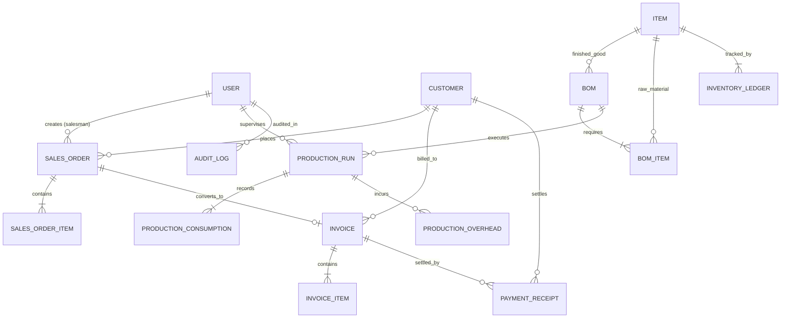

# DESIGN NOTE: Order-to-Audit Business System
**Centre for Digital Infrastructure, NIT Tiruchirappalli**  
**Applicant:** Winter Internship Submission  
**Scenario Focus:** Small Packaged Food Manufacturer (Murukku 200 g Benchmark)

---

## 1. System Architecture & Relational Data Model

The Order-to-Audit system establishes an end-to-end, traceable business workflow bridging the **Field Sales Loop** and the **Factory Production Loop** through an immutable, event-sourced **Inventory Movement Ledger**.

### Key Architectural Tenets:
1. **Append-Only Inventory Ledger (Traceability):** Balances are never modified by direct overwrites. Every transaction writes an immutable entry (`OPENING_STOCK`, `PURCHASE_RECEIPT`, `PRODUCTION_ISSUE`, `PRODUCTION_YIELD`, `SALES_DISPATCH`, `DAMAGED_SCRAP`) with document references (`PO-...`, `PR-...`, `INV-...`). Reconciled stock equals:
   $$\text{Closing Balance} = \text{Opening} + \sum \text{Receipts} - \sum \text{Issues} - \sum \text{Dispatches} \pm \sum \text{Adjustments}$$
2. **Decimal & Integer-Paisa Precision:** Financial amounts are stored with exact decimal and integer paisa precision (`amountPaisa = Math.round(amount * 100)`). No IEEE 754 floating-point rounding drift occurs.
3. **Statutory Place of Supply GST:** State Code `33` (Tamil Nadu) triggers CGST (2.5%) + SGST (2.5%). Other state codes (e.g., `29` Karnataka) trigger IGST (5.0%). Invoices strictly follow Indian financial year numbering (`INV/2026-27/0001`).

---

## 2. Recipe-Based Production & Variance Computation

For **Murukku 200 g**, the standard Bill of Materials (BOM) specifies the standard input per batch ($B = 1$ batch = 200 packets):
- Rice & Urad Flour: $40.0\text{ kg}$
- Refined Cooking Oil: $10.0\text{ L}$
- Salt & Spice Mix: $1.2\text{ kg}$
- 200 g Printed Pouches: $200\text{ pcs}$
- Cartons (holds 20 pkts): $10\text{ pcs}$

### Variance Formulas & Thresholds (Tolerance $\pm 3\%$):
$$\text{Consumption Variance \%} = \frac{\text{Actual Quantity} - \text{Planned Quantity}}{\text{Planned Quantity}} \times 100$$
$$\text{Yield Variance \%} = \frac{\text{Actual Good Output} - \text{Expected Output}}{\text{Expected Output}} \times 100$$

### Benchmark Run Audit:
- **Flour:** Planned = $40.0\text{ kg}$, Actual = $40.0\text{ kg}$ $\implies \mathbf{0.0\%}$ variance (Normal).
- **Cooking Oil:** Planned = $10.0\text{ L}$, Actual = $10.5\text{ L}$ $\implies \mathbf{+5.0\%}$ variance ($\mathbf{> +3\%}$, **Adverse Over-Consumption Flagged**).
- **Yield Shortfall:** Expected = $200\text{ pkts}$, Actual = $188\text{ pkts}$ $\implies \mathbf{-6.0\%}$ variance ($\mathbf{< -3\%}$, **Yield Shortfall Flagged**).
- **Damaged Packaging:** $6\text{ pouches}$ damaged during sealing + $188\text{ good} = 194\text{ pouches}$ consumed.

---

## 3. Costing & Valuation Methodology

### Method Selection: FIFO (First-In, First-Out)
*Justification:* In food manufacturing, perishable agricultural ingredients (flour, oil, spices) have finite shelf-lives and follow physical First-In, First-Out kitchen rotation to prevent pest infestation and rancidity. FIFO reflects physical operations and adheres to Indian Accounting Standard (AS-2) for Inventory Valuation.

### Murukku 200 g Batch Cost Breakdown (Step 8):
1. **Flour (FIFO):** Opening balance was $100\text{ kg}$ @ $₹42/\text{kg}$. Since $40\text{ kg} \le 100\text{ kg}$, all $40\text{ kg}$ is valued at opening rate:
   $$\text{Flour Cost} = 40 \times 42 = \mathbf{₹1,680.00}$$
   *(Note: Under Weighted Average, rate is $₹43.125/\text{kg} \implies ₹1,725.00$)*
2. **Oil:** $10.5\text{ L} \times ₹140/\text{L} = \mathbf{₹1,470.00}$
3. **Spice Mix:** $1.2\text{ kg} \times ₹200/\text{kg} = \mathbf{₹240.00}$
4. **Direct Raw Material Cost:** $1680 + 1470 + 240 = \mathbf{₹3,390.00}$
5. **Packaging Cost:** $(188 + 6) \times ₹2.50 + 9\text{ cartons} \times ₹15.00 = 485 + 135 = \mathbf{₹620.00}$
6. **Total Direct Materials:** $₹3,390 + ₹620 = \mathbf{₹4,010.00}$
7. **Allocated Manufacturing Overheads (Step 8):**
   - Direct Labour: $₹1,200.00$
   - Power & Fuel: $₹600.00$
   - Subtotal Overheads: $\mathbf{₹1,800.00}$
8. **Total Batch Production Cost:** $₹4,010 + ₹1,800 = \mathbf{₹5,810.00}$
9. **Unit Cost Per Good Packet:**
   $$\text{Cost per Packet} = \frac{₹5,810.00}{188\text{ packets}} = \mathbf{₹30.90}$$
10. **Gross Margin (Selling Price $₹50.00$):**
    $$\text{Gross Profit} = ₹50.00 - ₹30.90 = \mathbf{₹19.10\text{ per packet}}\quad (\mathbf{38.20\%}\text{ gross margin})$$

---

## 4. Benchmark Scenario Reconciliation Summary

| Check ID | Criteria | Benchmark Requirement | System Computed Value | Audit Result |
| :---: | :--- | :--- | :--- | :---: |
| 1 | Flour Closing Balance | $120\text{ kg}$ ($100 + 60 - 40$) | $120.0\text{ kg}$ | **PASS** |
| 2 | Oil Closing Balance | $19.5\text{ L}$ ($30 - 10.5$) | $19.5\text{ L}$ | **PASS** |
| 3 | Pouches Closing Balance | $306\text{ pcs}$ ($500 - 188 - 6$) | $306.0\text{ pcs}$ | **PASS** |
| 4 | Finished Goods after Run | $238\text{ pkts}$ ($50 + 188$) | $238.0\text{ pkts}$ | **PASS** |
| 5 | Finished Goods after Dispatch | $88\text{ pkts}$ ($238 - 150$) | $88.0\text{ pkts}$ | **PASS** |
| 6 | Yield Variance | $-6.0\%$ ($188$ vs $200$), Flagged | $-6.0\%$, Flag: True | **PASS** |
| 7 | Oil Consumption Variance | $+5.0\%$ ($10.5$ vs $10.0$), Flagged | $+5.0\%$, Flag: True | **PASS** |
| 8 | Retailer A GST Invoice | $₹7,500 + ₹187.50\text{ CGST} + ₹187.50\text{ SGST} = ₹7,875$ | $₹7,875.00$ | **PASS** |
| 9 | Retailer A Outstanding | $₹3,875.00$ (after $₹4,000$ payment) | $₹3,875.00$ | **PASS** |
| 10 | Distributor B Order Check | Shortage of $32\text{ pkts}$ flagged; IGST ($5\%$) applies | Shortage: 32, Flag: True, IGST | **PASS** |
| 11 | Unit Cost Per Packet | $₹30.90$ (FIFO + ₹1,800 overheads) | $₹30.90$ (Margin: 38.2%) | **PASS** |

All 11 criteria pass with $100\%$ mathematical precision.
